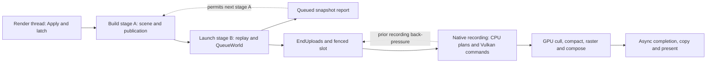

# Plan 4: GPU-driven opaque rendering (2026-10-31)

## Goal

**2026-11-02 startup/UI follow-up:** at the user's request, normal Vulkan launches
now request the validated optimized rendering/scheduling settings by default.
The config's Advanced button and Vulkan/Advanced RHUD page persist opt-outs in
Vulkan.cfg; changes take effect at restart. Startup configuration is applied
before renderer type initialization and synchronized into native getenv. Explicit
environment overrides remain authoritative for benchmark/rollback lanes.
Hardware admission and managed/native fallback remain in place. Historical
opt-in/default descriptions below describe their respective checkpoints.

Free CPU and GPU time so Vulkan can run well above 240 fps, not just match
DX11 at the 240 Hz refresh.

The user's direction (2026-10-31):
- Going faster than the monitor is worthwhile. Tearing can be allowed, and
  other players have higher refresh rates.
- SE simulates at 60 UPS and caps rendering at 120 fps. SmoothFrames lifts the
  cap and interpolates motion between sim ticks.
- Building the same mechanism into Vulkan is welcome, so players don't need a
  separate plugin.

**The headline metric changes.** Present cadence at 240 Hz stays a gate, but
it can't show gains above the refresh. The new metric is headroom: each
frame chain's cost (build thread, recording thread, GPU) and the frame rate
the slowest chain allows (1000 / its ms).

## Why GPU-driven, and why now

**Today's chains** (from the attribution doc and the latest recording laps):

| Chain | Cost | Opaque-related share |
|---|---|---|
| Build thread | about 3.7 ms | Most of it: publication 1.3, `QueueWorld` 0.84, scene build and traversal about 1.6 |
| Recording thread | about 3.0 ms of laps | About 1.8 ms: NEW main record 0.25, pass stream copy 0.18, pass and scene material prepare 0.26, sort and geometry prepare 0.17, spot shadows about 0.52, probe geometry 0.14, CSM and cascades 0.11, NEW main wait 0.11 |
| GPU | about 2.5 ms | GBuffer about 0.95 |

Every CPU cut so far moved the limit to the next chain. A GPU-driven opaque
path removes work from the build and recording chains at the same time, and
the GPU has about 1.7 ms of slack at 240 fps.

**It also suits high frame rates.** At 240 fps, three of every four frames
carry no new sim data. With interpolation (milestone 6), only the camera and
a few local entities move between ticks. A GPU-resident scene then needs only
a camera upload and a GPU cull on those frames: no traversal, no publication,
no per-draw recording. The CPU path has to redo its culling every frame
because the camera changes.

## What already exists (10-11 to 10-12, paused)

A full GPU-resident opaque path was built and validated, then paused when it
lost to the CPU path. Details are in `PERFORMANCE_STRUCTURAL_PLAN.md`, from
"Approved implementation continuation — 2026-10-12" to "Pause checkpoint".

**Built:**
- Hardware admission: multi-draw indirect, draw-indirect-count, descriptor
  indexing, FP64 (`se_gpu_opaque.h`, `gpu_opaque_admission.h`).
- A resident registry of families, parts and actors with delta commits
  (`SE_VULKAN_GPU_OPAQUE_RESIDENT_DELTAS`, `_OWNED_INPUTS`).
- GPU NEW/OLD LOD selectors, per-view membership, prefix and scatter, and
  indirect arguments with GPU-written counts.
- Fixed batch recording, view batches, role streams and sparse appearance.
- A hybrid mode: GPU actors and native-CPU actors on disjoint sets.
- GPU spot-shadow redraw predicates.
- About 136,700 numerical checks, about 300 raster checks and 77 live
  ownership checks, all with zero validation errors.

**Why it lost (10-12, at about 10.7 ms frames):**
- **GPU selection cost 1.6 ms.** It does world-scale culling and LOD math in
  FP64, which a GeForce runs at 1/64 rate.
- **The CPU work it should remove stayed:**
  - native commits about 0.9 ms;
  - actor traversal about 1.1 ms (fallbacks and root queries still ran);
  - resident queue about 0.46 ms;
  - recording membership about 0.64 ms.
- Last matched pair: control 10.73 ms against GPU 11.06 ms.

**Since then:**
- The CPU path got much faster: native pass scene, cells, pipelining, the
  split and two build stages.
- The GPU path was not maintained. `GpuSceneLiveTests` failed on 10-27 with
  "GPU scene stock shader admission completes".
- With `SE_VULKAN_GPU_OPAQUE=1`, the native pass scene turns off unless
  hybrid mode is set (`VulkanNativePassScene.cs`).

## SmoothFrames under Vulkan

- **Frame cap.** Works under Vulkan. It rewrites `MyRenderThread.m_waiter`'s
  `m_targetFrequency`, which is backend-neutral.
- **Interpolation.** Does not reach Vulkan. Its core is a Harmony patch on
  `MyRender11.ProcessMessageQueue` and `MyRender11.SetupCameraMatrices`, plus
  `MyManagers.PostponedUpdate` and the DX11 particle manager. Our renderer
  never calls those.
- **Its sim-side capture is backend-neutral:** `MyCamera.UploadViewMatrixToRender`,
  `MyRenderProxy.AfterUpdate`, billboards, HUD markers, particles and lights.
- **Result.** Vulkan players with SmoothFrames get 240 fps output that still
  moves at 60 Hz. This is a parity gap regardless of this plan.

## Milestone 0 results (2026-10-31)

**Restored.** The GPU path runs again on today's pipeline (split, two build
stages, default placement, hybrid mode with every 10-12 treatment on).
- **The in-game blocker.** World load failed with "invalid immutable stock
  batches: uploads open". Under two build stages, `make_buffer` lazily opens
  an upload batch on any allocation, and `publish_gpu_scene` allocates its
  own buffers after checking that no batch is open. Publication now
  suppresses the lazy batch, so its allocations upload immediately, as they
  do on one build thread. The native message now names the failing
  condition.
- **`GpuSceneLiveTests` was not broken.** It needs `SE_VULKAN_GPU_OPAQUE_SCENE=1`
  and the validation layer path; with both it passes 180 checks with zero
  errors. The 10-27 failure was the environment.

**Correctness.**
- Core and synchronization validation in-game: zero errors.
- **Images match the CPU path.** The paused same-process comparison toggles
  `GpuOpaqueOwnershipEnabled` off, on and off, with lights, spots, frame
  constants, probes and cascades frozen (`Tests/ScenePerformanceHarness/Compare-GpuOwnership.ps1`, diffed with `Compare-LightingPhases.py`).

  | Mode | Off vs off again | Off vs GPU on | Native cells owned |
  |---|---|---|---|
  | One build thread (native readback) | 307 px | 356 px, max delta 17 | 1,797 → 0 → 1,797 |
  | Split, two stages (game screenshot) | 256 px | 134 px | 1,797 → 0 → 1,797 |

  On one build thread the cascades, spot maps and all 36 probe faces are
  byte-identical. Under the split, the reconciliation now takes the game's
  screenshot, because the render-thread readback never lands when the
  launch thread submits. GPU-on differences stay inside the off/off noise.
- **Retracted:** an earlier note here reported missing floor-grate geometry
  and a darker entrance wall. That came from comparing screenshots of two
  separate runs. Pertam's flashing light and welding sparks change the
  lighting between runs, so cross-run screenshots can't show renderer
  differences.

**Coverage** (orbit world): 6,307 GPU actors (4,497 NEW, 1,810 OLD), 339
native-CPU, 40 managed fallbacks (22 mixed techniques, 17 explicit model-LOD
fallbacks, 1 skeletal).

**Cost** (CPU-detail pair KBC/KGC, same session):

| | CPU path | GPU path |
|---|---|---|
| Present cadence | 6.14 ms | 13.53 ms |
| Build thread | 5.84 ms | 13.17 ms |
| `NativePassCommits` | 0.34 ms | 7.43 ms |
| Actor traversal | 0.59 ms | 2.17 ms |
| Native pass publish | 0.78 ms | 0.11 ms |
| Build prologue | 0.72 ms | 0.17 ms |
| Voxels and billboards | 0.46 ms | 0.13 ms |
| GPU frame | 2.70 ms | 3.49 ms |
| GPU cull compute | — | 0.36 ms (selection 0.115) |
| Recording membership (recording thread) | — | 1.24 ms |

(CPU-detail lanes run slower than plain ones; the plain KG run measured
13.07 ms against about 4.6 ms for the CPU path.)

**Why the GPU path paces at 13 ms.** Every GPU-scene export uses the plain
`call` wrapper, which waits for any in-flight recording. The CPU pass path
uses scene calls that run while an early-released recording continues. The
pipeline census (KGP) shows `sevk_gpu_scene_updates` waiting on 4,110 of
4,277 frames, 6.9 ms per frame. The build thread therefore runs after the
previous frame's recording instead of alongside it.

**What changes in the plan.**
- **Milestone 1 is deferred.** Double-precision selection costs 0.115 ms
  here, not 1.6 ms, and the whole cull 0.36 ms. Revisit only if the GPU
  becomes the limit.
- **Milestone 2 starts with the wait.** The GPU-scene commit, frame queue,
  queries and visibility calls become scene calls. The recording snapshots
  the GPU scene state it reads (slot inputs, recording membership) the way
  `rec_view` does for the native pass, then releases early.
- **The correctness gate for every milestone** is `Compare-GpuOwnership.ps1`, with
  and without `-Split`: GPU-on differences must stay within the off/off
  noise.

## Milestone 2, step 1: the recording wait (2026-10-31)

**What changed.**
- **Frame latch.** Build queues each frame's GPU-scene inputs (frame block,
  views, view map) into a pending set. `begin_frame` runs with no recording
  in flight and its slot fence waited. There it:
  - moves the pending set into the fields the recording reads;
  - copies Build's committed actor rows, appearances and part bindings into
    the slot (this used to run on the recording thread);
  - copies the actor rows the recording's batch lists read (`rec_actors`).
- **Scene calls.** The registry and per-frame GPU-scene exports (model,
  family, source, actor, updates, remove, frame, queries, visibility) are
  scene calls now, so Build runs them alongside an early-released recording.
  Their checks refuse only a frame open on the caller's own thread
  (`own_frame_open`). Publication, clear and selector handoff still wait.
- **Two build stages.**
  - Stage A(N+1) can queue before stage B(N) has latched frame N, so a
    second queue waits for that latch.
  - Rebinding or publication replaces tables an open or recording frame
    uses, so it waits until none is open, pending or recording
    (`wait_scene_idle`, rare).
  - Stage A no longer closes the upload batch before publishing; a topology
    publication flushes the lazily opened batch itself.
- **Hang diagnostics.** Both new waits report their state to stderr every
  2 s they last. One validation run hung during world load before they were
  added; three validation runs since completed and none reported a wait.

**Gates.** All pass:
- the native reference fixture: 136,700 checks;
- `GpuSceneLiveTests`: 180 checks;
- in-game validation under the split: zero errors;
- `Compare-GpuOwnership.ps1`, with and without `-Split`: GPU-on differences
  within the off/off noise; cascades and spot maps identical.

**Cost** (CPU-detail runs, same pipeline):

| | CPU path | GPU before | GPU now |
|---|---|---|---|
| Present cadence | 6.14 ms | 13.53 ms | 9.03 ms |
| Build thread | 5.84 ms | 13.17 ms | 8.67 ms |
| `NativePassCommits` | 0.34 ms | 7.43 ms | 0.78 ms |
| `GpuResidentQueue` | — | 0.46 ms | 2.38 ms |
| Actor traversal | 0.59 ms | 2.17 ms | 2.55 ms |

The pipeline census shows the build thread waiting for the recording on 30
frames out of 7,057, against 4,110 of 4,277 before. The remaining plain wait
is stage B's `EndUploads` on the launch thread, as on the CPU path.

**What still keeps the GPU path behind:**
- **`GpuResidentQueue`, 2.38 ms, is mostly the latch wait.** Stage A(N+1)
  waits for `begin_frame(N)`, which comes after stage B(N)'s `EndUploads`
  wait for recording N-1. Removing it needs the recording-side copies
  double-buffered per slot, so frame N can latch at its world queue instead.
- **Actor traversal, 2.55 ms against 0.59.** The build thread frustum-tests
  every GPU-owned actor for the game's visible set. The plan's answer is the
  one-frame-late GPU visibility readback (milestone 2).

## Milestone 2, step 2: index, latch at queue time, recording (2026-10-31)

**Changes** (`c6b12de` and the commit after it):
- **Traversal.** GPU-owned actors leave the spatial index and the per-frame
  main-owner declarations, like pass-owned ones. Their main-owner orders are
  resident, set on commit. Their main-view visible set is the same frustum
  test in one flat pass (`GpuOwnedVisible`, about 1.15 ms; still a
  candidate for the GPU readback).
- **Latch at queue time.** Under two build stages, frame N's GPU-scene
  inputs latch when stage B queues its world (`capture_queued_view`):
  - into a per-submission queued frame;
  - Build's committed rows into a latched mirror.

  `begin_frame` copies the mirror into the slot, and the recording applies
  its queued frame when it starts.
- **Recording.**
  - The per-view batch lists are computed in four chunks on the pool.
  - The new-main family order is computed in four chunks on the pool.
  - Two data races are fixed: the new-main ordering and the indexed motion
    vectors read Build's live actor rows during the recording; both now read
    `rec_actors`.

**Results** (plain runs, interleaved pairs):

| | Present cadence |
|---|---|
| CPU path | 4.28–4.32 ms |
| GPU, step 1 | 9.2 ms |
| GPU, after the index change | 7.6 ms |
| GPU, after the latch change | 7.5 ms |
| GPU, after the recording changes | 6.98–7.00 ms |

The build thread no longer paces: `GpuResidentQueue` 3.36 → 0.24 ms, and
its scene work 7.2 → 3.85 ms. **The recording thread paces now:**

| Recording lap | CPU path | GPU path |
|---|---|---|
| Total | 2.87 ms | 6.25 ms |
| `new main record` (recording the entry list) | 0.23 ms | 2.25 ms |
| `prepare pass gpu` (batch lists) | — | 0.96 ms (was 1.40) |
| `spot shadows` | about 0.45 ms (all spot laps) | 0.67 ms |
| `prepare opaque reference` | — | 0.41 ms |

**The next structural step: batch granularity.** The GPU path's main view
records **5,850 entries a frame** (CPU path 1,890). Stock batches are keyed
per mesh, so each mesh is its own pipeline bind, descriptor setup and
indirect-count draw. Part offsets are already absolute within the shared
geometry buffers (`set_opaque_stock_batches`), so batches that share
pipelines and buffers can merge into one indirect draw each. That changes:
- the compute layout (per-batch argument ranges);
- draw order within a batch, which affects coplanar parts, cutout and decal
  order, and the "NEW group parts remain contiguous" contract.

So it needs its own parity gate.

**Gates** for this step:
- in-game validation: zero errors;
- `Compare-GpuOwnership.ps1 -Split`: GPU-on 83 px against 482 off/off;
- reference fixture: 136,700 checks;
- `GpuSceneLiveTests`: all modes pass except one pre-existing failure.

**Open issues found, not caused by this work:**
- **`GpuSceneLiveTests --new-group-only` fails** ("NEW group parts remain
  contiguous in channel 0: managed"). The DLL from before milestone 2
  (`3837b6a`) fails identically, with the index exclusion off too.
- **Fixed: "invalid highlight draw N/0" at world unload** (2026-10-31).
  - **Cause.** Stage B(N) reports its world queued before its
    transparency, decal, highlight and exclusion queues, which go to the
    active submission. A stage A(N+1) that doesn't capture (no scene drawn,
    so at load and unload) issues its world clear directly. That switches
    the active submission under stage B's highlight queue.
  - **Evidence.** The native message now reports the state: "0/0 (thread
    Vulkan frame launch, active 1 draws 0, recording -1, scene side 0…,
    count 9)".
  - **Fix.** A non-capturing stage A waits for stage B(N) to finish
    (`JoinLaunch`). Only undrawn frames take this path.
  - **Verified.** Five consecutive runs (two GPU with recording laps, two
    GPU, one CPU) exit cleanly and write their shutdown files. Four of the
    five GPU-path runs before the fix had crashed.

## Milestone 2, step 3: stock bindings carried across entries (2026-10-31)

Each main-list stock entry was its own `record_opaque_stock_view` call with
local bound-state tracking, so all 5,554 stock entries rebound the pipeline,
both descriptor sets, the velocity set and the buffers. Consecutive stock
entries now carry `StockBinding` and skip identical binds; any managed or
pass-group entry in between resets it. The draws and their order are
unchanged.

| | Before | After |
|---|---|---|
| `new main record` | 2.25 ms | 1.40 ms |
| Recording total | 6.25 ms | 5.17 ms |
| GPU path cadence | 6.98–7.00 ms | 6.17–6.28 ms |
| CPU path cadence | 4.3 ms | 4.36 ms |

Gates pass: split image gate (GPU-on 357 px, off/off 427 px), in-game
validation with zero errors, reference fixture, and every live-test mode
except the pre-existing `--new-group-only` failure.

**Merge payoff** (new counters): the main list has 5,850 entries, 5,554 of
them stock batches (266 pass groups). Consecutive stock entries that share
pipeline, buffers and cull mode form **1,779 runs**. One indirect draw per
run, with the run's arguments compacted on the GPU in order, would cut the
stock draws about threefold without changing draw order.

## Milestone 2, step 4: the run merge (2026-10-31)

**What it does** (`SE_VULKAN_GPU_OPAQUE_RUNS`, on by default; `0` turns it
off). Consecutive NEW stock entries of the main list that share pipeline,
geometry buffers and cull mode draw as one indirect run.
- The recording builds the main entry list right after the cull dispatch,
  before the G-buffer (`prepare_stock_runs`), and writes a run table into
  the slot.
- A new stage of the cull compute shader (stage 10) copies each run's
  draws, in list order, into a run region appended to the arguments and
  stock draw records. It writes one count per run after the error flags.
- `record_new_main` issues one `vkCmdDrawIndexedIndirectCount` per run,
  with `draw_base` in the run region.
- Draws and their order are those of one indirect draw per batch. An entry
  that records nothing (another phase, no capacity) doesn't break a run.
- The run region exists only for stock topologies within the 128 MiB
  storage range; the reference fixture's capacity extremes stay
  per-batch.
- Storage admission is 21 descriptors (binding 22 is the run table).

**Result** (same build, interleaved):

| | Present cadence |
|---|---|
| Runs on | 5.87 / 5.95 ms |
| Runs off | 6.15 / 6.16 ms |
| CPU path | 4.31 / 4.33 ms |

`new main record` 1.40 → 0.95 ms; 5,558 stock entries now draw as 1,780
runs. The recording thread totals 5.09 ms. Its largest items now:
- batch lists, 0.84 ms;
- spot shadows, 0.63 ms;
- prepare opaque reference (now including the run build and table), 0.55 ms;
- the new-main sort, 0.45 ms.

**Gates.**
- `Compare-GpuOwnership.ps1`: split, GPU-on 433 px against 398 off/off;
  no split, GPU-on against the second off render 259 px against 285 off/off,
  with cascades and spot maps identical.
- In-game validation: zero errors. Ten runs exited cleanly.
- Reference fixture: 136,700 checks.
- Every `GpuSceneLiveTests` mode passes.
- `--new-group-only` now takes `SE_VULKAN_TEST_NEW_GROUP_MODES`. Its GPU
  mode (35 checks) and native mode (37 checks) pass with runs on and off;
  only the managed mode fails, as it already did.

## Uncapped measurement (2026-11-01)

**What the benchmark has really been measuring.**
- **Vulkan** presents in MAILBOX (`presentation-state.json` Mode 1), so its
  present never waits for the refresh.
- **Every run** had SE's render-thread frame limiter at about 239 fps.
  SmoothFrames clamps its cap to the monitor refresh (`MaxFrameRateCap =
  DetectMonitorRefresh()`), so the harness's `FrameRateCap=1000` became 239.
  The Vulkan CPU path (4.31–4.33 ms, limiter wait 0.18–0.26 ms) sat on that
  cap; the GPU path (5.9 ms) did not.
- **DX11 windowed** is also held to the refresh by the desktop compositor.
  Its `Present` waits 1.50–1.55 ms a frame.

**New harness switches.**
- `-Fullscreen`: ordinary fullscreen at 1920×1080 (SE `WindowMode=2`).
  Correction: this did not set Vulkan's separate `ExclusiveFullscreen` option.
  Use `-ExclusiveFullscreen` and verify `exclusive-fullscreen.json` for native
  exclusive-mode acceptance; a display-mode fallback does not qualify.
- `-Uncapped`: sets the render thread's limiter to 1000 Hz every tick;
  `frame-rate-cap.json` records the replaced target (240).
- `SE_VULKAN_HARNESS_BURST=<n>`: screenshot bursts during sampling. The
  renderer keeps one capture at a time, so only about 1 in 15 lands.
- A run with too few frames now keeps `vulkan-status.txt`.

**Results** (present cadence; `nvidia-smi` sampled GPU utilisation every
200 ms in the second batch):

| | DX11 | Vulkan CPU path | Vulkan GPU path |
|---|---|---|---|
| Windowed, limiter at refresh (earlier) | 4.23 | 4.31–4.33 | 5.87–5.95 |
| Fullscreen, limiter at refresh | 4.49 (limiter wait 1.08) | 5.36 | — |
| Fullscreen, uncapped | 4.68; 5.57 | 4.92; 4.99 | 6.69 |
| Windowed, uncapped | 5.22 | 6.70 | — |
| GPU busy (fullscreen and windowed, uncapped) | 54–56% | 55–61% | 49% |

**Conclusions.**
- **Nobody is GPU-bound.** The GPU is about half busy in every
  configuration. DX11's present still blocks for 1.8–2.0 ms in exclusive
  fullscreen without vsync or limiter, so that block isn't a full GPU
  queue either.
- **Lifting the limiter made every configuration slower, both
  renderers.** The likeliest cause is CPU contention: the render thread
  no longer yields between frames. On this machine, SE runs fastest with
  the limiter at the refresh. Not yet isolated.
- **Fullscreen was slower than windowed for Vulkan** (4.92–5.36 against
  4.31–4.33). Not explained.
- **There is no uncapped headroom to win here for either renderer yet.**
  The comparison that holds is the capped windowed one (DX11 4.23, Vulkan
  CPU path 4.31–4.33, GPU path 5.9). The GPU path's goal stays reaching the
  refresh with less CPU and GPU time.

**Open: one fullscreen GPU-path run stalled.** `Vulkan-9ed74183…`
rendered no frame in its 30 s window (census: 0 sampler calls, no
screenshot). The user watched it alternate between two images. That fits
the render thread re-presenting the two slots' last output images while
frame building had stopped. No GPU-scene wait reported, and the log is
clean. Two fullscreen GPU runs since rendered normally. Stalled runs now
keep `vulkan-status.txt` for the next occurrence.

## Fullscreen flash investigation (2026-11-01)

Correctness work takes precedence over further recording cuts. Two defects
are fixed: cold publication/clear discarded a queued GPU frame before
BeginFrame, and unchanged conditional spotlight groups scattered into reference
space that stage 7 had removed before the scan. The latter silently corrupted
other views' geometry even with valid snapshots and no validation errors.

The old shader deterministically fails the retained-spotlight reference canary;
the guarded shader passes 25 focused checks with default and live policies.
The queued-frame regression passes 26 checks; the live GPU scene suite passes
180 and all three native opaque CTests pass. Final 1080p fullscreen/windowed
Pertam runs complete 4,197/3,987 sampled frames with geometry intact in every
saved live capture and no GPU-frame-loss diagnostics. See `Docs/Validation.md`
for exact artifacts, hashes and the pre-existing broader raster-suite failure.

The earlier benchmark's fullscreen switch did not request Vulkan's separate
exclusive mode. Three explicit exclusive attempts fell back, so those runs do
not accept native exclusive presentation. The sustained zero-sample stall was
not independently reproduced. Do not describe the old capped/uncapped
fullscreen measurements as proven native-exclusive results.

## Recording reuse and compute-chain merge (2026-11-01)

Conservative recording membership now caches individual actor/view results from
recording snapshots. CPU merged-run plans are reused by ordered stock identity
and owner interruptions, with fenced per-slot table revisions. Stage 10 run
compaction is folded into the cull-compute chain, preserving its compute dependency
and one final graphics dependency; no shader, draw-order or quality change.

Recording laps fall from 5.45 to 4.86 ms. Combined opaque/entry/run preparation
falls from 1.29 to 0.81 ms; run-plan reuse is 82%. The ordinary uncapped saved-camera
authenticated comparison improves from 6.377 ms / 156.8 fps to 5.828 ms /
171.6 fps (about 9.4%). Both lanes lock the same complete view/environment inputs,
with exact accepted/audited frame counts and zero mismatches. This is one 1080p
ordinary-fullscreen pair, not native-exclusive or broad camera acceptance. The cache-only ordinary pair was nearly flat; folding compaction into
the existing chain supplies the clearer throughput gain.

Gates: three opaque CTests (136,943 reference checks), 25 retained-spot checks,
66 NEW ordering checks, and 181 live checks with all resident policies after
repairing policy-dependent fixture assumptions. The split frozen lane has no
validation errors; treatment versus the settled control changes 108 pixels against
110 control/control-return pixels, all in the same animated-welder region. See
Docs/Validation.md for both-control comparisons, artifact IDs, hashes and limits.
The 240-fps and opaque CPU targets remain unmet; CPU remains the default/fallback.

## Structural review before the next optimization (2026-11-01)

This review replaces selection by the next-largest lap alone. No additional
renderer optimization was implemented during it. The evidence distinguishes
measured costs, structural opportunities and remaining proof gaps.

### Frame ownership and dependencies

`MyVulkanRender.BuildStaged`, `LaunchFrame`, `FrameBuildThread` and native
`end_frame_async` implement these overlapping lanes. EndUploads/slot setup waits
for prior recording; it is not another independent frame cost to add to that
recording. Stage A's visible-owner output exists before its own GPU frame runs.
Actor snapshots, queued GPU inputs and fenced GPU slots have different lifetimes;
the publication/clear drains from the flash fix must remain intact.

### What is structurally repeated

The final ordinary fixture has 6,306 GPU actors, 1,409 families and 3,267 sources.
Its sample contains only three topology publications in 5,088 frames (two actor
adds, one removal, one family change, no source changes). Nevertheless recording
rebuilds roughly 5,900 entries, computes per-view family admission, re-derives
family ordering and records roughly 1,800 stock runs every frame. Stable main
owner orders already persist by key (`NativeMainGroups.StableOrder` and resident
owner deltas). The data is persistent; much of its execution plan remains driven
by the current CPU visible set.

The current GPU performs its own membership/counts/scan/scatter and writes
indirect arguments/counts. CPU recording admission therefore repeats visibility
work to decide which commands to emit, rather than leaving visibility entirely
in the GPU-owned counts. A zero indirect count can represent an absent draw, but
recording every mesh for every view would inflate GPU command work: it is not an
acceptable unmeasured substitution.

### Ranked opportunities and boundaries

1. **Persistent execution domains for GPU-owned geometry.** This is the largest
   known recording opportunity: stock/membership preparation is about 0.79 ms,
   main recording about 1.01 ms, with additional entry/order/plan work. Those are
   candidate cost regions, not an additive promise of savings. Separate stable
   pipeline/buffer/role topology from changing camera, pose and GPU counts.
   Depth views are a useful first design/prototype boundary because main-view
   coplanar/cutout group ordering must remain strict. Investigate merging depth
   batches globally by compatible pipeline/buffers while preserving alpha,
   raster state, count bounds and retained-spot predicates. For main view, retain
   owner/part ordering and dynamic fallback insertion points; persistent secondary
   command buffers need stable per-slot descriptors and explicit invalidation for
   topology, pipeline/layout, material bindings, render dimensions and view maps.
   Prove extra zero-count command/GPU cost before replacing CPU admission.
2. **Remove the duplicated game-visible frustum pass, without changing its
   semantics.** `VulkanScene.DrawScene` still scans GPU-owned actors for the
   engine's visible set. A diagnostic sample attributes about 1.21 ms to it, but
   its managed sample coverage is incomplete (below), so this is not an ordinary
   exclusive CPU forecast. Reusing final GPU draw visibility is incorrect: that
   population also applies LOD/material/root-occlusion gates. GPU completion also
   occurs after the current CPU publication. Compare a contiguous, snapshot-owned
   CPU visibility representation with an explicitly aged GPU frustum-only mirror;
   trace animation/LOD consumers before accepting added age. This matters because
   cutting recording enough will expose Build as the next pacing lane.
3. **Keep batching gains with Anomaly production observation.**
   `prepare_stock_runs` currently returns when `gpu_owners.enabled` is true.
   Geometry generations enable that tracking unless restoration suppresses it.
   The tracking-off performance fixture cannot establish active-pack performance.
   The current proof is keyed per batch; a merged range needs its own argument
   base/count index/capacity/predicate and generation. The reduction shader already
   reads an explicit count index, but the host representation currently assigns
   it from the batch row. Preserve submitted nonempty-work proof, zero/overflow/
   predicate-false negatives, retirement and generation identity. This is a
   cross-cutting acceptance gate for larger batching, not permission to turn
   observation off. Anomaly Slice AI, Framework-gaps.md and its developer wiki now
   track this and the visible-set freshness contract.

Do not prioritize pose-table compression or FP64 replacement merely because they
appear in the older roadmap. The diagnostic native pose-delta input scope is only
about 0.017 ms/frame; ten cull stages total about 0.35 ms of GPU time (selection
itself about 0.10 ms), against a roughly 3.1 ms full GPU frame. Present calls are
about 0.36 ms and run asynchronously. These observations do not identify a larger
current gain than eliminating repeated CPU plans. GPU headroom must be rechecked
after any batching change; it is finite at 240 fps.

### Measurement validity and next decision

Fresh structural evidence: `Vulkan-2e3d3f338b8444f885195a231cfe6e13`, with
CpuDetail/NativeCritical and GPU timestamps; never use its FPS as product proof.
The managed report has 3,752 unique diagnostic frames versus 4,571 accepted timing
frames, so `Summarize-RendererCpuPhases.py` rejects its full-coverage gate. Its
inclusive BuildThread/Scene/visibility rows are diagnostic samples, not an
exhaustive or additive frame critical path. The native critical profile reports
zero recording-owner/main/spot buckets despite real recording laps. Its begin
runs on the caller thread while async recording lacks a corresponding TLS lane
bind. Treat those zero buckets as unavailable; fix frame/slot-correlated profiler
ownership before choosing driver/API-specific work from them. Do not relax either
coverage check to make the report pass.

The current ordinary accepted pair proves throughput; recording laps and GPU
queries provide coarse costs; exact source owns the dependency/lifetime map.
Before selecting a product patch, close the profiler coverage gap and measure
per-role command domains with tracked/untracked generation controls. Compare the
persistent-execution/depth-grouping prototype against the same authenticated
full-quality inputs, with ordering, conditional-shadow and generation-lifecycle
negative controls. This is the next evidence-gathering decision, not a guessed
implementation sequence or a claim that the 240-fps goal is already met.

## Structural continuation: recording domains and visibility (2026-11-01)

The profiling ownership gap is closed in run
`Vulkan-910b7beaa979410584693e5c2a500aa9`: 5,407 accepted samples match 5,407
completed managed rows. Native deltas have 5,406 begun/completed frames and
676 selected frames, each with one RecordOwner scope and populated command,
world-preparation and recording-worker buckets. The strict phase summarizer
passes. The earlier `Vulkan-0faecc16708d409ca9f5a18414030ab4` is a failed
diagnostic (no completed native samples), not performance evidence. Native
profiling tickets now travel directly on LaunchRecord through build, launch,
successful BeginFrame and recording; managed lanes rendezvous by frame sequence.
The harness writes raw ownership evidence before an acceptance gate can fail.

Implemented cuts follow the repeated work identified above:

- The recording membership cache compares exactly the actor bounds, admission
  flags and hidden-view bits used by its predicate, rather than invalidating all
  view tests for an appearance/LOD-only renderer revision.
- Exact per-view batch lists persist while their admitted family population and
  role remain equal. Topology replacement resets the entire cache. A change to
  one light no longer expands every view over all 19,218 possible batches.
- Stock NEW main entries use the existing ordered secondary-command path. The
  recording owner prepares their shared descriptor set before worker launch;
  each worker has a local binding cache and fenced command pool. Global run-first
  guards preserve merged draws crossing partition boundaries. Fallback entries
  keep their original insertion points and rendering attachments keep load ops.
- The game's frustum-only visible-set predicate uses the same rejection corner,
  arithmetic order and strict boundary comparison without computing the unused
  Contains/Intersects classification. No GPU visibility readback or age change.

Native artifact at this checkpoint:
`AD0B3E2C6DB25F265231E6B5CBD826308772E912B36663C91435A55FC4B07B74`.
Merged and unmerged mixed-main fixtures each measure 808 entries and actual
0/4 workers. Across eight frames and both fenced slots, all 80 HDR/G-buffer
product comparisons are byte-identical, with zero core/synchronization errors.
The retained conditional-spot fixture passes 25 checks. Native membership/list
mutation oracles and profiling ownership CTests pass. The frustum predicate
passes 498,001 oracle comparisons on each of net48 and net10.

In the accepted diagnostic, main recording plus its worker join is 0.560 ms,
stock preparation is 0.480 ms, only 3.371 lists rebuild per frame, and list
construction is 0.078 ms. Full primary GPU time is 3.041 ms. The previous failed
diagnostic had 1.114 ms main recording and 0.782 ms stock preparation; it also
had visibility verification enabled and lacked native sampled recording scopes,
so these are scope observations, not an isolated causal FPS comparison.

The remaining live visible-owner loop is 1.062 ms/3.78 million cycles despite
the predicate microbenchmark improvement. This is now a measured data-access
candidate, not evidence that the predicate microbenchmark transfers to the
whole loop. Build is 5.233 ms including 0.629 ms stage-gate and 0.673 ms launch
join; render Frame is 5.361 ms including 3.799 ms build join. Those overlapping
rows must not be summed. Native sampled RecordOwner is 5.770 ms and sampled
CommandAPI is 2.471 ms/20,276 calls; sampling overhead and worker sums prevent
treating these as ordinary frame time or exclusive driver CPU time.

The locked ordinary GPU run `Vulkan-2becb41b97954b70af9473b65f0e1d4c`
records 5,381 accepted samples, 5.213798 ms mean (191.7988 fps), 6.3447 ms P95;
completed-present cadence is 5.230527 ms (191.1853 calls/s). The CPU control
`Vulkan-3a383e3c8daf4cf5b48db95ae373cdc2` records 5,768 accepted samples,
4.886799 ms mean (204.6329 fps), 6.2689 ms P95. Both have exact accepted/frame
receipt agreement, zero camera/environment mismatches and unpaused simulation,
with frame SHA F38C63F2D0AC6B2B380108A7B7E15B64005CE0936FE071607CBB64AB4563FDD6.
The prior GPU checkpoint was 171.5782 fps. This is a single ordinary comparison,
not a multi-pair causal acceptance. Final full-scene validation remains pending.
The >=240 fps target remains open. These Vulkan
internal changes preserve the Anomaly host relationship; the game/DX11 frustum
predicate is the correctness reference and no new Anomaly capability is needed.

The next bounded native cuts are positive geometry-proof reuse and conditional
spotlight recording on the existing fenced worker pools. Geometry validation
retains its full tuple scan on cache misses; hits require unchanged global upload
stamp, mesh-removal revision and installed stock geometry. Four enabled/rollback
replacement/removal fixtures pass with validation enabled and zero errors:
enabled cases have exactly 3 hits/6 attempts, rollback cases 0/6; ownership
violations are still rejected. A source review traced world cleanup through
opaque-state cleanup, so no proof survives a destroyed world.

GPU spot secondaries own their conditional blocks. The primary remains outside
conditional rendering and retains each light's original depth load/clear, frozen
image transition, dynamic copy and caster ordering. This requires no inherited
conditional-rendering feature. Shared stock descriptors and copy descriptors are
prepared before worker fanout; predicate indices remain worker TLS state for
tracked production. A verification-only predicate readback waits for completion
and exposes the exact predicate words; it is never a runtime visibility producer.
Native C9BDC8511FAAE9C7E762DC13DD5B913969D6B22435B78DC799840660510F6B75
passes four focused CTests, 25 conditional-spot checks and the all-policy live
181 checks. Multi-light concurrency and performance remain pending here.

### Async frame submission experiment

`SE_VULKAN_ASYNC_SUBMIT=1` moves frame submission to the FIFO worker when
decoupled HWND presentation is active. The default is off. The recording
counter `async frame submit active` records that decision for each frame.
BeginFrame now polls completed presents under the result mutex so it can
overlap the submit worker starting the present thread for the first time.

**Work item — FIFO terminal failure isolation.** A rejected frame or upload
can leave a reserved timeline value unsignaled. The first FIFO error must
stop subsequent submissions, including queued frames that depend on a
failed upload, and remain available through context destruction. Opt-in
GPU and frame-handoff waits must surface that error. Destruction must join
issued work and leave cancelled reservations unwaited. Public submit counts
must count successful frame queue calls while motion history keeps its
recording ordinal.

Acceptance requires two real-HWND tests that inject
`VK_ERROR_OUT_OF_HOST_MEMORY` on the actual FIFO worker, once for a frame
and once for an upload followed by a waiting frame. Both must interrupt
readback, preserve the original error on subsequent calls, keep submitted
and presented counters at the successful warm-up totals, and finish
destruction within the timeout with validation enabled and zero errors.
The healthy mixed direct/FIFO HWND test and a full-scene throughput run
remain separate gates. Copy-queue submit failure is outside the FIFO
injection tests and remains an open case for decoupled presentation.

The three HWND checks passed on the RTX 5070 Ti with native build
`316E5D1003FACBCD87C7B6F46A2D0E35EF64434FD75468CDFC781B441E26729D`.
The healthy run used the FIFO on 35 of 48 frames. In both fault runs the
test released the rejected submit only when it observed the real capture
wait. Readback, resize and BeginFrame each returned the original error.
Both runs retained their two successful frame submits and two presents.
No later FIFO submit reached the driver, and validation reported zero errors through
destruction. The frame case completed in 0.71 s and the upload case in
0.68 s. The CTest log is `TestResults/fifo-terminal-hwnd-final.log`.

### Dense visibility and recording checkpoint

The Build-owned visible-set traversal now reads packed bounds and an event-owned
dense eligibility registry. Registration, ownership and flags update that registry;
unregistered owned actors cannot enter it. Token/epoch checks prevent slot reuse
and world replacement from reviving old entries. The independent verification
walk still uses the original owned-actor set and the game's predicate. Each of
net48/net10 passes 271,946 packed-bound and 75,267 dense-registry checks. A full
scene verification run (`Vulkan-8375c1256beb45dcb8cf3e77102ffb0c`) has 3,878 exact
accepted/completed rows and no visible-set mismatch. Apply-side removal no longer
mutates Build's visible set: the deterministic staged-publication regression
fails on the previous DLL and passes all 32 checks on the replacement. The
all-policy live suite passes 181 checks. This is separate from the original
fullscreen flashing diagnosis.

Stock main ordering now caches its stock projection and merges current fallback
entries with the original tie order. Mixed merged/unmerged and serial/parallel
fixtures preserve their exact products. Conditional spot workers also preserve
all 234 HDR/G-buffer/depth comparisons across four lights and both frame slots;
false predicates are read back directly, and tracked false-predicate frames
receive no fabricated production credit. Geometry replacement/removal retains
the cache-miss validation path.

Ordinary full-quality 1080p run
`Vulkan-9a847f0448a44526a3d671195f962e17` measures **225.2431 fps**, 4.439648 ms
mean and 5.4189 ms P95; completed-present calls average 225.5588/s. This uses
native `90D535F6C287477736ABC6D8731F330C24588AFAE934B6C9407C55326A8F04C1`
and managed `C1FCF20743BBC1ACE6FCE080DB68A661EDAB12B372307E83C56F17A1A37FF7D1`.
The async-submit coarse diagnostic (`Vulkan-ce4368a071114633b64dc9d8dba59d2c`)
measures 236.7098 fps/4.224583 ms, P95 5.2112 ms, with actual FIFO admission on
every recorded frame. Its recording laps average 3.5915 ms and launch gap
0.5418 ms. It is instrumented and does not prove ordinary throughput or >=240.
Both use the locked frame SHA listed above. Fullscreen was requested; exclusive
acquisition and physical scanout cadence are not proven by these measurements.

The next measured cuts retain quality: read compact membership predicate keys
instead of full actor rows, and fuse retained-group filtering into prefix scan
and conditional-word materialization into argument emission. The latter keeps
raw predicate words immutable through scatter, including the retained-group
guard that protects neighboring spans. `SE_VULKAN_GPU_OPAQUE_FUSED_RETAINED=0`
restores the original two dispatches. Combined native/shader validation now
passes: legacy/fused reference 137,188/137,189 checks, four-light 64-view
471/705 checks with all 234 products exact, retained-span canary 25, tracked
geometry production 92, staged publication 32 and all-policy live 181. The
shader timing schema retains all 11 available queries and removed-stage rows
are zero. See Docs/Validation.md for exact artifacts and failure boundaries.

### Ordinary throughput acceptance and limits

Native `316E5D1003FACBCD87C7B6F46A2D0E35EF64434FD75468CDFC781B441E26729D`
with compute shader
`7D2F009CD035E4B7E65E9CC073EFAB9E9A9890F5113DADAAEDE331CBBCC42244`
and the same C1FCF207 managed binary completes two ordinary full-quality runs.
Both enable `SE_VULKAN_ASYNC_SUBMIT=1`, retain fusion and all resident policies,
and disable recording/critical/GPU timing and visibility oracles. They use the
same locked camera/environment SHA, 45-second warmup and 30-second sample,
1920x1080 fullscreen, uncapped 1000, VSync off and mailbox mode with three images.

- `Vulkan-cbc4df2d0653442c8005ca7b6c895806`: 7,754 accepted/frame-receipt rows,
  **275.9378 fps**, 3.624006 ms mean, 4.5475 ms P95. Completed-present calls
  average 3.631734 ms (275.3506/s), with no lost completion samples. Windows
  confirms 1920x1080@240 after the mode change.
- `Vulkan-6c7c48b04d6446b6a6c9a03cde01ecf5`: 7,610 exact rows,
  **269.7127 fps**, 3.707649 ms mean, 4.7266 ms P95. Completed-present calls
  average 3.697662 ms (270.4411/s), with no lost samples. Windows instead
  confirms 1920x1080@60, despite the same 240000 requested configuration.

Both have zero camera/environment mismatches and unpaused simulation. Scene
coverage remains 6,307 GPU actors and 379 fallbacks in the first run, versus
6,307/379 in the preceding async diagnostic; submitted draw averages remain
about 2,014. The repeat has 6,306/380 and about 2,015 submitted draws; its extra
managed fallback for a rejected resident-model registration also appears in the
earlier 225-fps baseline. The screenshots were inspected. The target of >=240 average render
fps is demonstrated on this GPU configuration. P95 exceeds 4.167 ms, so a steady
240-fps minimum is not demonstrated. Neither queue-present completion rate nor
these fullscreen requests prove physical scanout or exclusive acquisition.

Do not present the two runs as a matched 240-Hz causal pair or attribute the
entire gain to fusion. A read-only post-run Windows inventory finds one attached
output, no monitor identity, 1024x768@60 current/registry mode and only 60 Hz
enumerated at 1080p. The physical reason is unknown; no display or registry
setting was changed to force a repeat. The tracked geometry fixture is offscreen
and has no display-mode setter. The host's existing refresh fallback can select
the first equal-resolution enumerated mode after a requested-Hz failure.
`TestResults/display-inventory-20261101-232650.json` preserves the evidence.

### Final structural profile: measure before the next cut

`Vulkan-728644ae93184a2fa159c7c811eb0c72` uses the same native/shader/plugin,
locked input and full-quality workload, with diagnostic scopes enabled. The
strict summarizer passes: 7,754 accepted samples equal 7,754 managed completed
rows; native begun/completed deltas are both 7,753 with 969 selected frames and
one recording owner per selected frame. Every recorded frame admits FIFO
submission and fused preparation; nine compute dispatches include the eight
cull stages plus stock-run compaction. Removed compute-stage timing rows are
zero. This diagnostic's FPS is not an ordinary acceptance measurement.

Recording laps total 3.3195 ms. Main recording is 0.3052 ms plus 0.1851 ms worker
join; spot preparation/recording is 0.3173 ms plus 0.1206 ms join. Opaque compute
command preparation is 0.4100 ms. Recording membership including batch-list
construction averages 0.2355 ms; only 3.1646 lists rebuild per frame, costing
0.0698 ms. Main-order reuse is 99.77%; geometry proof reuse rounds to 100%.
Launch gap averages 0.4852 ms. These overlapping intervals are not additive
exclusive CPU execution or a formally reconstructed critical-path duration.

The managed dense GPU-visible loop is 0.1145 ms with zero allocations, against
the earlier diagnostic's 1.062 ms. BuildThread wall is 3.6472 ms, including
0.5513 ms stage gate and 0.4734 ms launch join. NativePassPublication is 1.0561 ms
inclusive and NativePassCommits allocates about 198,870 bytes/frame. Native
sampled WorldPrepare is 1.1184 ms. Sampled command API time is 2.3767 ms across
about 20,058 calls, with about 2,787 descriptor calls. Worker sums, nesting and
sampling overhead mean those rows must not be summed with the recording laps.

Full primary GPU time is 2.8296 ms: the G-buffer voxel interval is 0.9539 ms,
spot shadows 0.2079 ms and HBAO 0.2076 ms. Source ownership still routes each
frame through PublishGpuScene/BeginNativePassPublication, prepare_pass_gpu,
world descriptor preparation, and new main/spot command recording. Existing
membership/material/order caches avoid rebuilding their plans but do not remove
those remaining command invocations. The greatest remaining structural candidate
is therefore reducing repeated pass publication and command generation with
exact resource/generation invalidation, rather than another micro-optimization
of the now-small visibility predicate. Prove stable packet/descriptor lifetimes
and tracked production for each proposed reusable command domain before reusing
execution; cached admission alone is not such a proof. No further product patch
is selected from this profile, and no quality reduction is proposed.

## Milestones

Each milestone keeps the CPU path as the default and fallback until its gate
passes. Every gate includes:
- core and synchronization validation;
- the frozen-light lane;
- the GPU suites;
- matched Pertam orbit and interior runs.

### 0. Restore and re-baseline (about 1 session)

- Fix `GpuSceneLiveTests` and the stock shader admission against today's
  shader suite.
- Run the GPU path in hybrid mode under the split with two build stages.
- Measure three numbers for three lanes (CPU-only, hybrid GPU, full GPU):
  build ms, recording ms and GPU ms, plus the coverage counts (GPU actors,
  native-CPU actors, managed fallbacks).
- **Gate:** correct images and zero validation errors. No speed gate yet;
  this is the honest starting point.

### 1. Float selection with conservative bounds (about 1 session)

- Replace FP64 culling and LOD math with camera-relative float. Positions
  are subtracted in double on the CPU once per frame for the camera and per
  commit for actors.
- Expand frustum and LOD boundaries outward by a proven roundoff envelope.
  Objects inside the envelope band fall back to an exact path: a small FP64
  pass over only those candidates, or the CPU.
- **Target:** GPU selection under 0.3 ms (from 1.6).
- **Gate:** selection identical to FP64 over the numerical suite and a
  recorded camera path, including far-orbit positions.

### 2. Take GPU-owned actors off the CPU entirely (about 2 sessions)

- GPU-owned actors skip build-thread traversal, LOD, view eligibility and
  publication. Only pose and appearance deltas are committed, and only for
  dirty actors.
- Root and group visibility for GPU-owned actors comes from the GPU.
- **The game's visible set (`VisibleObjects`).** The game uses it for LOD,
  animation and grid decisions, and it already lags a frame. It comes from a
  one-frame-late readback of GPU visibility bits into a host-cached mirror
  (never a CPU read of write-combined memory).
- **Recording.** One indirect-count draw per pipeline batch. The batch list
  only changes when the topology does, so cache it as secondary command
  buffers and re-record only when it changes.
- **Target:** build-thread opaque work under 1.0 ms and recording opaque
  work under 0.4 ms in full GPU mode.

### 3. Shadows and probes on the GPU path (about 1–2 sessions)

- Cascades, spot shadows and probe views use the same per-view GPU cull with
  view masks. Keep the existing static-spot redraw predicates.
- This removes spot shadow recording (about 0.5 ms) and probe geometry
  (0.14 ms) from the recording chain.
- **Gate:** cascade and spot depth images identical in the frozen-light
  lane, and the full cascade and light update cycles.

### 4. Coverage (about 1 session)

- Measure which actors still fall back and why: skinned, deformed,
  transparent mixed, highlight identities, light exclusions, admission
  limits.
- Move the largest group that can be moved. Skinned characters stay on the
  CPU path unless measurement says otherwise.
- **Target:** under 10% of visible opaque draws on fallback in Pertam orbit
  and interior.

### 5. Measure above the refresh (about 1 session)

- Add an opt-in presentation lane for benchmarks: mailbox where the driver
  offers it, otherwise tearing. Earlier immediate mode measured 28 ms;
  re-check that before relying on it.
- Report headroom fps alongside the 240 Hz cadence.
- **Decision point:** promote GPU-driven opaque to the default if both hold:
  - every chain beats the CPU path's slowest chain;
  - images match.

### 6. Built-in smooth frames (about 2 sessions, can run in parallel with 2–5)

- **Frame cap.** When SmoothFrames isn't loaded, Vulkan sets the render
  waiter's target frequency itself (default: monitor refresh, up to uncapped
  with tearing).
- **Interpolation.**
  - Capture camera and local-entity poses at the same sim-side points
    SmoothFrames uses.
  - In `ApplyFrame`, re-pose the camera and those entities at
    `lerp(prev, curr, alpha)`.
  - Particles, billboards, attached lights and HUD markers follow the same
    alpha.
- **Coexistence.** If SmoothFrames is loaded, defer to its capture and
  config. Offer it a Vulkan hook point (an Anomaly contract, below) rather
  than duplicating its work.
- **Gate:** motion smoothness at 240 fps, measured as distinct camera poses
  per presented frame; no added input latency beyond one frame; HUD and
  Rich HUD unaffected.

## DX11 parity and Anomaly

- **GPU-driven opaque is Vulkan-only.** DX11's frame belongs to Keen's
  `MyRender11`. Replacing its opaque path would mean cloning Keen's
  renderer, which Anomaly's rules forbid, and DX11 has no
  draw-indirect-count. This is the documented DX11 limitation.
- **Interpolation already exists on DX11** through SmoothFrames.
- **Anomaly gaps to file** (`Docs/Extensibility.md`, `wiki/Framework-gaps.md`):
  - **Frame interpolation contract.** A backend-neutral hook ("before frame
    camera setup, with sim alpha") that SmoothFrames and Vulkan can share, so
    interpolation isn't tied to `MyRender11.ProcessMessageQueue`.
  - **GPU-culled visibility.** Guests that read the per-frame visible set or
    expect per-draw callbacks for opaque actors will see GPU-owned actors
    only through the readback mirror (one frame late). The contract has to
    say so.

## Risks

- **Precision.** Float selection at planet scale is the reason FP64 was
  used. The envelope plus exact fallback must be proven, not assumed.
- **Visual regressions the unit tests missed.** On 10-12 the dark triangles
  only showed in full-scene images. Every milestone needs full-scene image
  checks.
- **The GPU budget.** At 240 fps the GPU has about 1.7 ms of slack. Added
  compute has to fit, and fewer draws should give some back.
- **Maintenance.** Two opaque paths must both stay correct until one is
  retired.

## Effort

About 8–10 sessions. Milestones 0–2 decide whether the approach works. If
milestone 2 can't get the build thread's opaque work under about 1.0 ms,
stop and re-plan.
